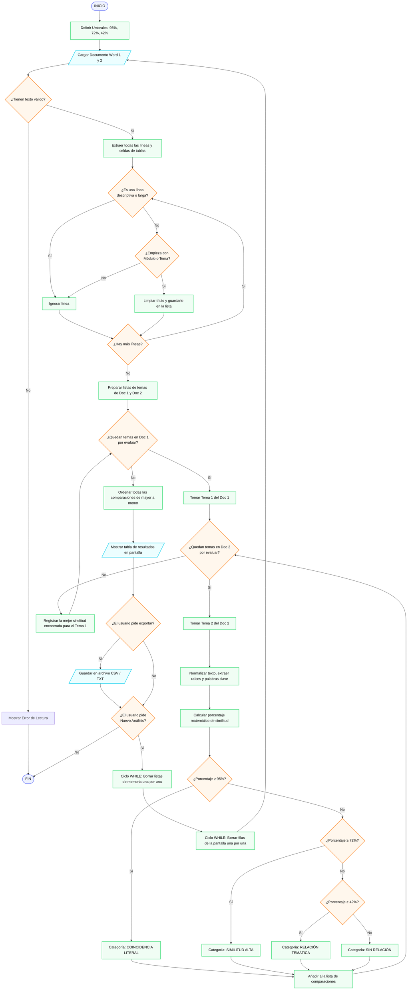

# 🎓 Comparador Académico 2.0

Sistema web interactivo desarrollado en **Python** y **Streamlit** para la evaluación y contraste sistemático de planes de estudio contenidos en documentos Word (`.docx`).

---

## 🚀 Acceso en la Nube

La aplicación está desplegada y lista para usarse sin necesidad de instalación local:  
👉 **[Abrir Comparador Académico en Streamlit Cloud](https://comparador-academico.streamlit.app)**

---

## 🎯 Objetivo y Funcionalidades

- **Ámbito exclusivo:** Localiza y analiza automáticamente las páginas correspondientes al **Plan de Estudios**, omitiendo secciones de admisiones, claustrales, rankings y metodologías.
- **Extracción precisa de temas:** Extrae módulos (`1.`, `2.`) y temas principales (`1.1`, `1.2`), descartando estrictamente subtemas (`1.1.1`) y texto descriptivo.
- **Análisis algorítmico combinado:** Evalúa similitud textual mediante secuencias `difflib`, raíces morfológicas del español y filtrado de palabras clave.
- **Clasificación y recomendaciones oficiales:**
  - 🟢 **Coincidencia Literal ($\ge 95\%$):** *Posible sustitución (Coincidencia exacta de títulos)*
  - 🔵 **Similitud Alta ($72\% - 94.9\%$):** *Posible sustitución (Alta coincidencia textual)*
  - 🟡 **Relación Temática ($42\% - 71.9\%$):** *Similitud que requiere revisión (Relación temática)*
  - ⚪ **Sin Relación ($< 42\%$):** *Sin relación identificada (Coincidencia insuficiente)*
- **Exportación de informes:** Descarga inmediata de resultados detallados en formatos **CSV (compatible con Excel)** y **TXT estructurado**.

---

## 📊 Diagrama de Flujo del Sistema

A continuación se representa la arquitectura de control y procesamiento del sistema:



---

## 📝 Pseudocódigo del Algoritmo

```text
ALGORITMO ComparadorAcademico
    // 1. Constantes y Umbrales Oficiales de Clasificación
    DEFINIR UMBRAL_LITERAL <- 95.0
    DEFINIR UMBRAL_ALTA <- 72.0
    DEFINIR UMBRAL_TEMATICA <- 42.0

    // 2. Control Principal de Ejecución (Estructura WHILE)
    DEFINIR sesion_activa <- VERDADERO

    MIENTRAS sesion_activa = VERDADERO HACER
        // Carga y validación de documentos Word (.docx)
        LEER archivo_doc1, archivo_doc2
        
        SI NO es_docx(archivo_doc1) O NO es_docx(archivo_doc2) ENTONCES
            MOSTRAR_ERROR "Formato no válido: únicamente se admiten archivos Word (.docx)"
        SINO
            // Extracción y delimitación exclusiva del Plan de Estudios
            lineas_doc1 <- EXTRAER_LINEAS_Y_TABLAS(archivo_doc1)
            lineas_doc2 <- EXTRAER_LINEAS_Y_TABLAS(archivo_doc2)

            seccion_doc1 <- DELIMITAR_PLAN_ESTUDIOS(lineas_doc1)
            seccion_doc2 <- DELIMITAR_PLAN_ESTUDIOS(lineas_doc2)

            temas_doc1 <- EXTRAER_TEMAS_PRINCIPALES(seccion_doc1) // Filtra 1.1 y descarta 1.1.1
            temas_doc2 <- EXTRAER_TEMAS_PRINCIPALES(seccion_doc2)

            // Comparación Sistemática entre Documentos (Estructura FOR anidada)
            DEFINIR lista_comparaciones <- LISTA_VACIA()

            PARA CADA tema1 EN temas_doc1 HACER
                DEFINIR mejor_similitud <- 0.0
                DEFINIR mejor_match <- NULO

                PARA CADA tema2 EN temas_doc2 HACER
                    // Normalización y cálculo léxico/morfológico
                    texto1_norm <- NORMALIZAR(tema1.titulo)
                    texto2_norm <- NORMALIZAR(tema2.titulo)

                    similitud, explicacion <- CALCULAR_SIMILITUD(texto1_norm, texto2_norm)

                    // Clasificación Oficial y Recomendación (Estructura IF / ELIF / ELSE)
                    SI similitud >= UMBRAL_LITERAL ENTONCES
                        categoria <- "COINCIDENCIA LITERAL"
                        recomendacion <- "Posible sustitución (Coincidencia exacta de títulos)"
                    SINO_SI similitud >= UMBRAL_ALTA ENTONCES
                        categoria <- "SIMILITUD ALTA"
                        recomendacion <- "Posible sustitución (Alta coincidencia textual)"
                    SINO_SI similitud >= UMBRAL_TEMATICA ENTONCES
                        categoria <- "RELACIÓN TEMÁTICA O PARALELA"
                        recomendacion <- "Similitud que requiere revisión (Relación temática)"
                    SINO
                        categoria <- "SIN RELACIÓN IDENTIFICADA"
                        recomendacion <- "Sin relación identificada (Coincidencia insuficiente)"
                    FIN_SI

                    REGISTRAR(lista_comparaciones, tema1, tema2, similitud, categoria, recomendacion, explicacion)
                FIN_PARA
            FIN_PARA

            // Ordenamiento y Despliegue de Resultados
            ORDENAR_POR_SIMILITUD_DESCENDENTE(lista_comparaciones)
            MOSTRAR_METRICAS_Y_TABLA(lista_comparaciones)

            // Exportación opcional
            SI usuario_solicita_exportar() ENTONCES
                EXPORTAR_CSV_Y_TXT(lista_comparaciones)
            FIN_SI

            // Reinicio de sesión interactivo
            SI usuario_solicita_reiniciar() ENTONCES
                // Limpieza de memoria (Estructura WHILE)
                MIENTRAS LONGITUD(lista_comparaciones) > 0 HACER
                    ELIMINAR_PRIMER_ELEMENTO(lista_comparaciones)
                FIN_MIENTRAS
                VACIAR_ARCHIVOS_CARGADOS()
                REINICIAR_INTERFAZ()
            SINO
                sesion_activa <- FALSO
            FIN_SI
        FIN_SI
    FIN_MIENTRAS
FIN_ALGORITMO
```

---

## 🛠️ Estructura del Repositorio

```text
├── streamlit_app.py    # Aplicación web completa y motor algorítmico autónomo
├── requirements.txt    # Dependencias mínimas (streamlit, python-docx, pandas)
└── README.md           # Documentación, diagrama de flujo y pseudocódigo
```

---

## 💻 Ejecución Local (Opcional)

Si deseas ejecutar la aplicación en tu propio ordenador:

1. Instalar dependencias:
   ```bash
   pip install -r requirements.txt
   ```
2. Iniciar la aplicación web:
   ```bash
   streamlit run streamlit_app.py
   ```
